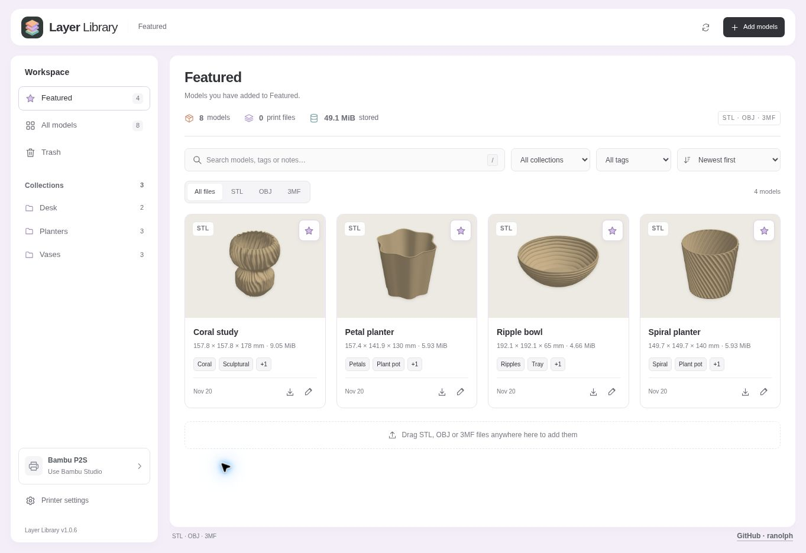
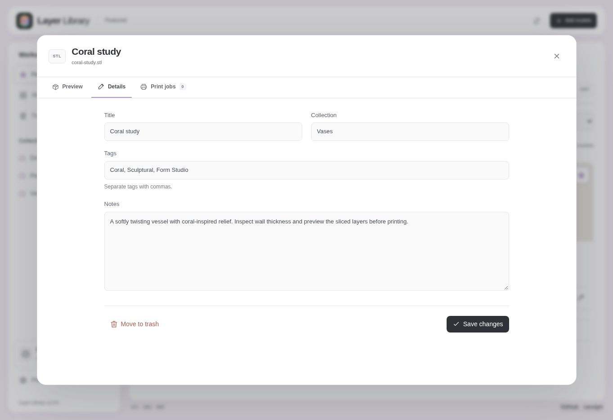
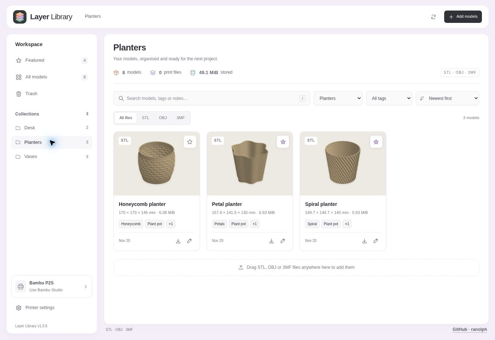
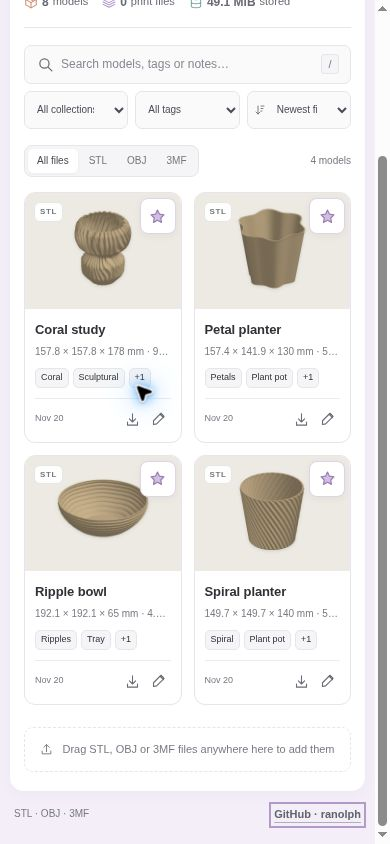

# Layer Library

A self-hosted home for your 3D printing models. Upload STL, OBJ and 3MF files, browse them visually, organise them into collections, and keep the sliced print file beside its original model.

Layer Library runs on TrueNAS or any host with Docker Compose. It also runs directly with Python. This is the portable **1.0.6** release, incorporating the OBJ, preview-image, Bambu Studio and Featured updates from the original application.

## Screenshots

Layer Library uses a pale lavender page background, pure white panels and neutral controls. Small purple accents match its icon, while the typography, headers and panel spacing remain consistent with Form Studio and Solid Studio. The GitHub link follows the complete workspace at the bottom of the page on mobile. The screenshots below use a separate demonstration library with sample models. **New installations start empty; these models are not preloaded or included in the application.**

### Library workspace



Browse your models visually, search the library and use the star button to keep favourites in Featured.

### Model details



Edit a model's title, collection, tags and notes while keeping its original file available to download or open in Bambu Studio.

### Collections



Group related models into collections while keeping tags, notes and attached print files with each model.

### Mobile library



The page scrolls through every model before reaching the GitHub footer. Printer settings follow the same layout.

## What it does

- Upload up to ten STL, OBJ or model 3MF files at a time, with duplicate-file detection.
- Rotate, pan and zoom an interactive 3D preview. Toggle the grid or wireframe and change the preview colour.
- Render STL/OBJ preview images on the server, use embedded 3MF pictures where available, and save an image from a successful browser preview.
- Search and sort models; edit titles, collections, tags and notes.
- Star models to show them in **Featured**, the default library view. New uploads are available under **All models** until starred.
- Show dimensions, triangle counts and a bounding-box fit check for the existing Bambu P2S profile.
- Download the original model without modifying its bytes.
- Move models to Trash and restore them without losing metadata or attached print files.
- Open models in Bambu Studio, including a geometry-only 3MF handoff for STL and OBJ files. Your original file remains available.
- Attach sliced `.gcode.3mf` jobs. An optional local connection transfers supported P2S jobs to printer storage.

**The library has no login or user accounts.** Everyone who can reach its web address can read and change the library. Run it on a trusted local network, or protect access separately. Browser sessions provide CSRF protection; they do not authenticate users. Do not expose the default service directly to the internet.

## Start with Docker Compose

Download or clone this repository, then run these commands from its folder:

```sh
docker compose up -d --build
docker compose ps
```

Open **http://localhost:8777** on that computer, or `http://your-server-hostname:8777` from another device on the same network. The first installation starts with an empty library. Choose **Add models** to add your own files, then use the star button to curate Featured.

The image is built locally from this repository; no pre-published image is required. The 3D viewer is already bundled, so you do not need Node.js or an npm build to run the app. Initial image construction downloads the Python base image and pinned Python dependencies. Normal local browsing and model storage do not require an internet connection.

Docker stores your database, original files, preview images and prepared Studio copies in the persistent `layer-library-data` volume. Recreating the container retains that volume. `docker compose down --volumes` deletes it.

For port or optional integration settings:

```sh
cp .env.example .env
# Edit .env, then apply the settings:
docker compose up -d --build
```

See [installation and operation](docs/installation.md) for TrueNAS, Python, storage permissions, backups and upgrades.

## Printing workflows

| Workflow | What Layer Library does |
| --- | --- |
| Any slicer | Download the original STL, OBJ or 3MF, then open and slice it in your preferred application. |
| Bambu Studio | Prepare a compatible 3MF handoff and offer a desktop link. Sign in, select your printer, slice and send from Studio. Layer Library does not use your Bambu account or send to Bambu cloud itself. |
| Optional P2S LAN transfer | Validate an attached P2S `.gcode.3mf`, then copy it to printer storage after local connection setup. Firmware support is required. This does **not** start printing or provide live telemetry. |

You can use the normal library with any printer. The fit badge and sliced-job checks currently use the Bambu P2S profile; they are not a configurable printer catalogue. A successful bounds check does not establish printability, supports, safe materials or the correct orientation. Review the model in your slicer.

STL and OBJ coordinates are interpreted as millimetres. OBJ preview and Studio conversion use geometry only; external `.mtl` files and textures are not imported. 3MF units and supported component transforms are inspected from the file. Large files can require explicit confirmation before loading a browser preview.

## Use it with Form Studio

Layer Library is independent of Form Studio. To send generated models directly from Form Studio, configure that app's Layer Library connection with the address it can reach:

- Separate installations on the same LAN: `http://your-nas-hostname:8777`.
- Containers that explicitly share a Docker network: `http://layer-library:8080` when the service is named `layer-library`.

`localhost` inside the Form Studio container refers to Form Studio itself. Separate Compose projects do not automatically share service-name DNS. Downloading an STL from Form Studio and uploading it here always remains available.

## Configuration

| Setting | Default | Purpose |
| --- | --- | --- |
| `LAYER_LIBRARY_PORT` | `8777` | Published host port in Compose. |
| `LAYER_LIBRARY_BIND` | `0.0.0.0` | Host bind address. Use `127.0.0.1` for access only from the Docker host. |
| `LAYER_LIBRARY_VOLUME` | `layer-library-data` | Docker named volume. Keep this stable across upgrades. |
| `DATA_DIR` | `./data` in Python; `/data` in Docker | Application data directory. Compose sets this automatically. |
| `MAX_UPLOAD_MB` | `250` | Server per-file limit in MiB. The browser also caps each selection at 250 MiB; this setting can lower the effective limit. Format inspection and conversion have additional limits. |
| `BACKUP_SERVICE_ORIGIN` | Empty | Optional origin of a separately installed Launchpad-compatible website-backups service. The backup button is hidden when unset. |

The optional backup client is included for existing compatible installations. A Google Drive backup service, Google credentials and a NAS installer are **not** bundled. The configuration and API expectations are described in the installation guide. Ordinary file or volume backups work without this integration.

## Development

Use Python 3.12 and Node.js 22 or later for the supplied contributor workflow:

```sh
python3.12 -m venv .venv
. .venv/bin/activate
python -m pip install -r requirements-dev.txt
python -m uvicorn app.main:app --host 127.0.0.1 --port 8777 --reload --no-proxy-headers
```

Run the Python test suite from this repository's root:

```sh
python -m pytest -q
```

The tests generate their own temporary geometry and databases. Printer network I/O is mocked. The large-3MF regression creates a substantial temporary mesh, so allow time and free temporary disk space for that test.

The frontend is plain HTML/CSS/JavaScript, with a locally bundled Three.js viewer. To change the viewer:

```sh
npm ci
npm run build
npm test
```

Commit changes to both `app/frontend/viewer.js` and its generated `app/static/viewer.bundle.js`. `npm run dev` is also available after activating the Python environment; it starts the same local Python server. The checked-in `package-lock.json` records the exact frontend build dependencies.

## Licence and contributions

Project code is available under the [MIT licence](LICENSE). Bundled dependencies retain their own notices in [THIRD_PARTY_NOTICES.md](THIRD_PARTY_NOTICES.md) and `licenses/`. You retain responsibility for the rights to any models you upload or redistribute.

See [CONTRIBUTING.md](CONTRIBUTING.md) for changes and [SECURITY.md](SECURITY.md) for the access model and reporting issues.

[GitHub · ranolph](https://github.com/ranolph)
